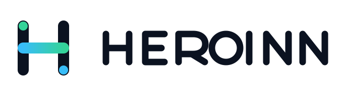
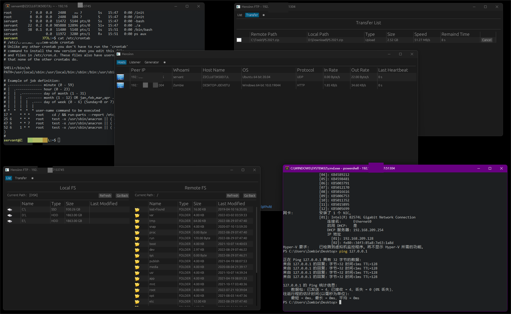

<p align="center">
  <picture>
    <source media="(prefers-color-scheme: dark)" srcset="image/heroinn-logo-dark.svg">
    <source media="(prefers-color-scheme: light)" srcset="image/heroinn-logo-light.svg">
    
  </picture>
</p>

<p align="center"><strong>English</strong> · <a href="README.zh-CN.md">简体中文</a></p>

<p align="center">
  <a href="https://github.com/b23r0/Heroinn/actions/workflows/ci.yml"></a>
  <a href="LICENSE"></a>
  <a href="https://discord.gg/ZKtYMvDFN4"></a>
</p>

# Heroinn

Heroinn is a cross-platform command-and-control and post-exploitation framework
written in Rust. It combines a desktop server application, lightweight agents,
an interactive PTY shell, a resumable file manager, and a client generator for
authorized security research and red-team exercises.

> **Authorized use only.** Use Heroinn exclusively on systems you own or have
> explicit permission to test. You are responsible for complying with all
> applicable laws and authorization requirements.



## Features

- Desktop GUI for managing listeners, online agents, shell sessions, and files.
- Interactive PTY shell with a dedicated terminal window per session.
- File manager with resumable transfers and large-file support.
- Client generator for producing agents with an embedded connection profile.
- Per-agent aggregate transfer-rate limit (default 1 MB/s), shared by all inbound
  and outbound traffic.
- TCP, HTTP, and reliable UDP transports.
- Windows 10+ (Windows Server 2019+), Linux, BSD, and macOS support.
- For TCP and HTTP communication, agents automatically discover the proxy from
  environment variables or the current desktop/user system settings and can
  connect through HTTP CONNECT, HTTPS (TLS-to-proxy when an explicit `https://`
  proxy URL is used), or SOCKS5. Reliable UDP and loopback IPC remain direct.

## Requirements

- Rust 1.95 or newer with Cargo.
- Linux build dependencies:

```sh
sudo apt-get install -y \
  build-essential pkg-config cmake libssl-dev \
  libfontconfig1-dev libfreetype6-dev libexpat1-dev \
  libx11-dev libx11-xcb-dev libxcb1-dev libxrandr-dev \
  libxi-dev libxcursor-dev libxinerama-dev \
  libxkbcommon-dev libxkbcommon-x11-dev libwayland-dev \
  libegl1-mesa-dev libvulkan-dev
```

- Windows: a normal Rust MSVC toolchain is recommended. Heroinn uses Schannel
  for TLS and does not require OpenSSL development packages.
- At runtime on Linux, the terminal component needs libX11, libxcb, libEGL,
  libwayland-client, libxkbcommon, and libvulkan.

## Build

```sh
git clone https://github.com/b23r0/Heroinn.git
cd Heroinn
cargo build --release --locked
```

The build produces four executables:

- `heroinn` — server GUI
- `heroinn_client` — agent
- `heroinn_ftp` — file manager
- `heroinn_shell` — terminal window used by interactive shell sessions

`heroinn_shell` must be placed next to the `heroinn` executable because the
server launches it from its working directory.

## Client generation

The server's **Generator** tab does not compile an agent. It copies a prebuilt
`heroinn_client` and rewrites its embedded connection stamp in place.

Templates are searched next to the running `heroinn` executable first, then in
the current working directory. Both legacy platform-suffixed names and normal
Cargo output names are accepted:

| Platform | Template names |
| --- | --- |
| Windows x86_64 | `heroinn_client_windows.exe`, `heroinn_client.exe` |
| Linux x86_64 | `heroinn_client_linux`, `heroinn_client` |
| BSD x86_64 | `heroinn_client_bsd`, `heroinn_client` |
| macOS x86_64 | `heroinn_client_darwin`, `heroinn_client` |

Build a native agent with `cargo build -p heroinn_client --release --locked` and
keep it next to the server. Cross-platform agents must first be compiled for
their target and copied under one of the matching names above.

The generated executable inherits the template's permissions, including the
Unix executable bit. Connection information is limited to 1024 bytes of JSON,
and the generator rejects templates containing more than one valid stamp.

## Workspace

| Path | Purpose |
| --- | --- |
| `heroinn` | Server GUI and controller |
| `heroinn_client` | Cross-platform agent |
| `heroinn_core` | Shared application-core logic |
| `heroinn_util` | Protocol, transport, packet, and utility layers |
| `th3rd/heroinn_ftp` | File manager |
| `th3rd/alacritty-driver` | Vendored terminal driver used by `heroinn_shell` |

First-party crates use edition 2024 and share dependency versions pinned at the
workspace root in `[workspace.dependencies]`. Vendored terminal crates retain
their upstream editions.

The vendored terminal driver removes the two inherited PTY backends because
Heroinn connects through a local TCP socket. The existing windowing stack is
kept on its current `glutin` release to avoid a separate full rewrite of the
terminal event loop.

## Continuous integration

The GitHub Actions workflow in `.github/workflows/ci.yml` runs on Linux and
Windows. It verifies `heroinn_ftp` formatting, runs Clippy with warnings denied
on all first-party crates, compiles the workspace, runs the applicable unit and
integration tests, and builds the release executables with the checked-in
`Cargo.lock`. The release job also patches a real `heroinn_client` binary to
prove that its embedded connection stamp survived optimization and remains
unique and discoverable.

The vendored `alacritty_terminal` library tests run independently. Its
historical reference-fixture suite is not part of CI because the corresponding
fixture tree is not included in this repository.

## Roadmap

- [ ] Usage documentation
- [ ] Reverse SOCKS5 proxy support
- [ ] Shellcode staging, loaders, and generator options
- [ ] Expanded protocol serialization and interoperability tests
- [ ] Broader cross-platform packaging

## Contributing

Bug reports, feature suggestions, pull requests, and documentation improvements
are welcome. Before opening a pull request, run the same checks used by CI:

```sh
cargo fmt -p heroinn_ftp -- --check
cargo check --workspace --lib --bins --locked
cargo clippy -p heroinn -p heroinn_client -p heroinn_core -p heroinn_util -p heroinn_ftp --all-targets --locked -- -D warnings
cargo test --workspace --exclude alacritty_terminal --locked
cargo test -p alacritty_terminal --lib --locked
cargo test -p alacritty_config_derive --test config --locked
cargo build --workspace --release --locked
HEROINN_CLIENT_TEMPLATE=target/release/heroinn_client \
  cargo test -p heroinn_util --test real_client_template --locked -- --ignored --exact patches_a_real_client_template
```

On Windows PowerShell, set
`$env:HEROINN_CLIENT_TEMPLATE = "target/release/heroinn_client.exe"` before running
the same test command.

Join the community on [Discord](https://discord.gg/ZKtYMvDFN4).

## License

Heroinn is distributed under the [GNU General Public License v3.0](LICENSE).
The project logo is an original asset distributed with the project under the
same license.
