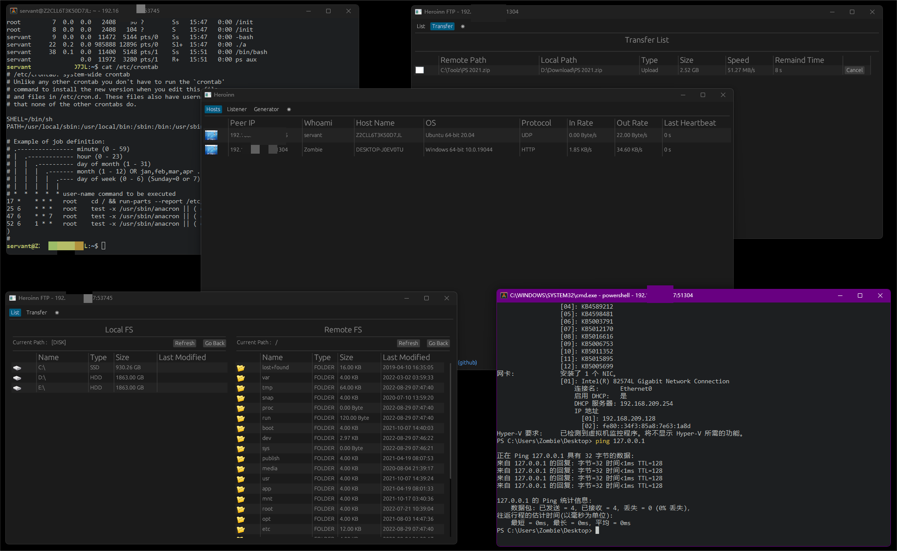

<p align="center">
  <picture>
    <source media="(prefers-color-scheme: dark)" srcset="image/heroinn-logo-dark.svg">
    <source media="(prefers-color-scheme: light)" srcset="image/heroinn-logo-light.svg">
    
  </picture>
</p>

<p align="center"><a href="README.md">English</a> · <strong>简体中文</strong></p>

<p align="center">
  <a href="https://github.com/b23r0/Heroinn/actions/workflows/ci.yml"></a>
  <a href="LICENSE"></a>
  <a href="https://discord.gg/ZKtYMvDFN4"></a>
</p>

# Heroinn

Heroinn 是一个使用 Rust 编写的跨平台命令控制与后渗透框架，包含桌面服务端、
轻量级 Agent、交互式 PTY Shell、支持断点续传的文件管理器以及客户端生成器，
用于获得授权的安全研究和红队测试。

> **仅限授权使用。** 请仅在您拥有或已取得明确测试授权的系统上使用 Heroinn。
> 使用者应自行遵守适用法律和授权范围。



## 功能特性

- 桌面 GUI，可管理监听器、在线 Agent、Shell 会话和文件。
- 交互式 PTY Shell，每个会话使用独立终端窗口。
- 文件管理器，支持断点续传和大文件传输。
- Agent生成器可以配置通过socks5代理连接服务器（支持和系统代理构成代理链）
- 设置每个 Agent 的总传输速率限制，默认 1 MB/s。
- 支持Socks5 Reverse Proxy（通过代理链）
- 支持 TCP、HTTP 和可靠 UDP 传输。
- 支持 Windows 10+（Windows Server 2019+）、Linux、BSD 和 macOS。
- 使用 TCP 或 HTTP 通信时，Agent 会自动读取环境变量或当前桌面/用户系统代理，
  并可通过 HTTP CONNECT、HTTPS（显式 `https://` 代理 URL 时以 TLS 连接代理）或
  SOCKS5 连接服务器；可靠 UDP 与本地回环 IPC 保持直连。

## 环境要求

- Rust 1.95 或更高版本及 Cargo。
- Linux 构建依赖：

```sh
sudo apt-get install -y \
  build-essential pkg-config cmake libssl-dev \
  libfontconfig1-dev libfreetype6-dev libexpat1-dev \
  libx11-dev libx11-xcb-dev libxcb1-dev libxrandr-dev \
  libxi-dev libxcursor-dev libxinerama-dev \
  libxkbcommon-dev libxkbcommon-x11-dev libwayland-dev \
  libegl1-mesa-dev libvulkan-dev
```

- Windows：建议使用标准 Rust MSVC 工具链。Windows 端使用 Schannel 处理 TLS，
  不需要安装 OpenSSL 开发包。
- Linux 运行时，终端组件还需要 libX11、libxcb、libEGL、libwayland-client、
  libxkbcommon 和 libvulkan。

## 构建

```sh
git clone https://github.com/b23r0/Heroinn.git
cd Heroinn
cargo build --release --locked
```

构建会生成五个可执行程序：

- `heroinn` — 服务端 GUI
- `heroinn_client` — Agent
- `heroinn_ftp` — 文件管理器
- `heroinn_shell` — 交互式 Shell 会话使用的终端窗口
- `heroinn_socks5proxy` — 在线 Agent 使用的反弹 SOCKS5 代理 GUI

`heroinn_shell`、`heroinn_ftp` 和 `heroinn_socks5proxy` 必须与 `heroinn`
可执行程序放在同一目录，因为服务端会从当前工作目录启动它们。

## 客户端生成

服务端的 **Generator** 页面不会编译 Agent，而是复制一个预编译的
`heroinn_client`，并原地改写其中嵌入的连接配置。

对于 TCP 和 HTTP Agent，Generator 还可以嵌入可选的 SOCKS5 代理配置。如果
生成的 Agent 同时发现系统代理，则会先连接系统代理，再连接配置的 SOCKS5
代理，最后连接服务端，形成代理链。UDP Agent 不提供 SOCKS5 配置。SOCKS5
凭据会嵌入生成的客户端二进制，并可能被提取。

模板会优先在当前运行的 `heroinn` 可执行程序所在目录中查找，然后搜索当前
工作目录。既支持带平台后缀的旧名称，也支持 Cargo 的标准输出名称：

| 平台 | 模板名称 |
| --- | --- |
| Windows x86_64 | `heroinn_client_windows.exe`, `heroinn_client.exe` |
| Linux x86_64 | `heroinn_client_linux`, `heroinn_client` |
| BSD x86_64 | `heroinn_client_bsd`, `heroinn_client` |
| macOS x86_64 | `heroinn_client_darwin`, `heroinn_client` |

使用 `cargo build -p heroinn_client --release --locked` 构建本机 Agent，并将
其放在服务端旁边。其他平台的 Agent 需要先为目标平台编译，再复制为上述对应
名称。

生成的文件会继承模板权限，包括 Unix 可执行位。连接信息最多使用 1024 字节
JSON；如果模板中存在多个有效连接标记，生成器会拒绝处理。

## 工作区结构

| 路径 | 用途 |
| --- | --- |
| `heroinn` | 服务端 GUI 与控制器 |
| `heroinn_client` | 跨平台 Agent |
| `heroinn_core` | 共享应用核心逻辑 |
| `heroinn_util` | 协议、传输、数据包和工具层 |
| `th3rd/heroinn_ftp` | 文件管理器 |
| `th3rd/heroinn_socks5proxy` | 反弹 SOCKS5 代理 GUI 与 sidecar |
| `th3rd/heroinn_shell` | `heroinn_shell` 使用的终端实现 |
| `th3rd/heroinn_conpty` | 仓库内置的 Windows ConPTY 支持 |

项目自身 crate 使用 edition 2024，依赖版本统一固定在 workspace 根目录的
`[workspace.dependencies]` 中；仓库内置的终端 crate 保留上游 edition。

仓库中的终端驱动已移除两个继承自上游的 PTY 后端，因为 Heroinn 通过本地 TCP
套接字连接终端。现有窗口栈继续使用当前 `glutin` 版本，以避免对终端事件循环
进行额外的整体重写。

## 参与贡献

欢迎提交 Bug 报告、功能建议、Pull Request 和文档改进。提交 Pull Request
前，请运行与 CI 相同的检查：

```sh
cargo fmt -p heroinn_ftp -- --check
cargo check --workspace --lib --bins --locked
cargo clippy -p heroinn -p heroinn_client -p heroinn_core -p heroinn_util -p heroinn_ftp -p heroinn_socks5proxy --all-targets --locked -- -D warnings
cargo test --workspace --exclude alacritty_terminal --locked
cargo test -p alacritty_terminal --lib --locked
cargo test -p alacritty_config_derive --test config --locked
cargo build --workspace --release --locked
HEROINN_CLIENT_TEMPLATE=target/release/heroinn_client \
  cargo test -p heroinn_util --test real_client_template --locked -- --ignored --exact patches_a_real_client_template
```

在 Windows PowerShell 中，请先执行
`$env:HEROINN_CLIENT_TEMPLATE = "target/release/heroinn_client.exe"`，再运行同一
条测试命令。

欢迎加入 [Discord 社区](https://discord.gg/ZKtYMvDFN4)。

## 许可证

Heroinn 使用 [GNU General Public License v3.0](LICENSE) 发布。项目 Logo 为
原创资产，并随项目使用相同许可证。
